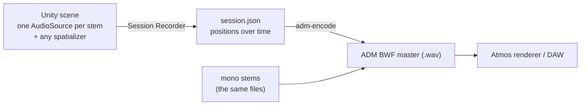

# unity-adm-recorder

Record 3D object movement in Unity, then encode it into a Dolby Atmos–compatible ADM BWF master.

> **Status: working prototype.** The pipeline runs end to end, and its masters have been played back and inspected in an Atmos toolchain during development. That's testing, not certification. It isn't a production tool; see [Known limitations](#known-limitations).



## How it works

Each stem sits on an object in a Unity scene. You move the objects while the stems play, and the recorder samples every object's position into `session.json`. It records **transforms, not audio**. What you hear in Unity is a preview from whatever spatializer you use; the real render happens later, in an Atmos renderer, from the positions stored in the master.

The encoder reads `session.json` and the original stems and writes one ADM BWF file: the stems interleaved as a multichannel WAV, plus the ADM metadata (`axml` and `chna` chunks) that describes each stem as a moving audio object, following Dolby's ADM profile conventions.

The two halves only share the [session format](docs/session-schema.md), so session files can come from anywhere, not just Unity.

## Quickstart: encode the demo

Needs Python 3.11 or 3.12.

```bash
git clone https://github.com/amaribrahim/unity-adm-recorder.git
cd unity-adm-recorder
python3.11 -m venv .venv
source .venv/bin/activate
pip install ./encoder
adm-encode examples/cmaj7-demo/session.json -o cmaj7-demo.wav
```

Open `cmaj7-demo.wav` in the Dolby Atmos Renderer, or any DAW or plugin that imports ADM BWF. You get four objects, one per note of a Cmaj7 chord, each following the path recorded in Unity. See [examples/cmaj7-demo](examples/cmaj7-demo/).

## Record your own session in Unity

Tested with Unity 6000.4.

1. **Install the package.** Window → Package Manager → **+** → **Add package from git URL**:
   ```
   https://github.com/amaribrahim/unity-adm-recorder.git?path=unity/com.amaribrahim.session-recorder
   ```
2. **Import your stems.** Mono, 48 kHz. Normally WAV exported from your DAW; OGG works too. Give every stem a unique file name.
3. **Build the rig.** Create an empty GameObject and add **Session Controller**, **Session Recorder** and **Session Playback Driver**, then drag the recorder and driver into the controller's fields. For each stem, add a *child* GameObject with an **AudioSource** (clip = the stem, Spatial Blend = 1, Play On Awake off) and an **Audio Object**. Give every object a unique name (playback matches objects by name). Add **Simple Orbit** to anything you want to circle the listener, or move objects any other way. Put the AudioListener (on the Main Camera by default) at 0, 0, 0 — the recorded positions are relative to the world origin, so that's where the listener is in the final mix.
4. **Pick a spatializer (optional).** Choose a spatializer plugin in Project Settings → Audio and tick **Spatialize** on each AudioSource. We used [atmoky trueSpatial](https://www.atmoky.com/). Any spatializer works, since only positions are recorded.
5. **Press Play.** Recording starts with the stems and stops when the longest one ends. Stay in Play Mode until the Console shows "Session saved to…" — leaving early discards the take. The take is saved as `Assets/Sessions/session_<timestamp>/session.json`. To hear a take again, set the controller's **On Play** to **Play Latest Session** and press Play.

Then encode it, pointing at the folder with your stems:

```bash
adm-encode Assets/Sessions/session_<timestamp>/session.json --stems-dir Assets/Stems -o master.wav
```

## `adm-encode`

```
adm-encode SESSION -o OUTPUT [--stems-dir DIR] [--keep-intermediates DIR]
```

- Each object's `stemFile` is looked up in `--stems-dir`, or, without it, next to the session file and then in a `stems/` folder beside it.
- Stems must be mono and 48 kHz, and all the same length. The encoder stops with a clear error otherwise.
- `--keep-intermediates DIR` also writes the generated `adm.xml` and `chna.json` so you can inspect them.
- Bit depth comes from the session's `bitDepth` (24 by default).

## Known limitations

This is a prototype. Things it deliberately doesn't do yet:

- **No timeline or transport.** A take always runs for the length of the longest stem, from the start.
- **Objects only.** No 7.1.2 bed and no LFE channel.
- **No loudness or mastering stage.** Output isn't delivery-ready for Apple Music or other streaming services, which have loudness requirements.
- **Distance attenuation isn't captured.** Every block's `gain` is written as `1.0`; the spatializer's rolloff isn't recorded.
- **48 kHz mono stems only**, and the recorder assumes 48 kHz.
- **No Dolby ADM profile validator.** Check masters with Dolby's own tools before delivering anything.

## License

- Code: [Apache License 2.0](LICENSE).
- Demo audio in `examples/cmaj7-demo/stems/`: [CC BY 4.0](examples/cmaj7-demo/LICENSE).
- The encoder builds on the EBU ADM Renderer ([`ear`](https://github.com/ebu/ebu_adm_renderer), BSD-3-Clause-Clear).

Dolby and Dolby Atmos are trademarks of Dolby Laboratories. This project isn't affiliated with or endorsed by Dolby.
